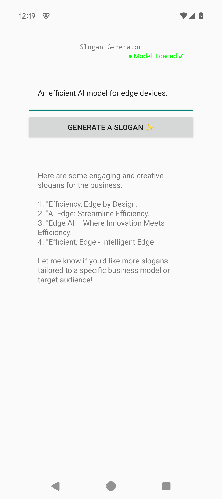

Slogan Generator
===
This example illusrate how to use llama.cpp for a single turn generation for certain product needs. The UI is implemented with [Android Views](https://developer.android.com/develop/ui/views/layout/declaring-layout).

Clone the cookbook with `git clone --recurse-submodules` to get the pinned llama.cpp source.

## Screenshot

