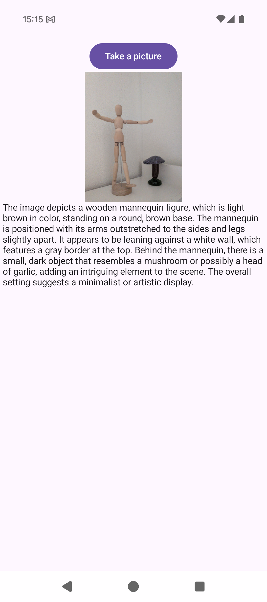

VLM Example
===
This is an example app to showcase vision language model (VLM) capability of LFM2.5-VL-1.6B running on-device with [llama.cpp](https://github.com/ggml-org/llama.cpp). 

## Introduction
The whole app is built with Jetpack Compose, and image rendering is provided by [Coli](https://coil-kt.github.io/coil/) library.

Clone the cookbook with `git clone --recurse-submodules` to get the pinned llama.cpp source. The app downloads the model and its vision projector from Hugging Face on first use.

## Screenshot

