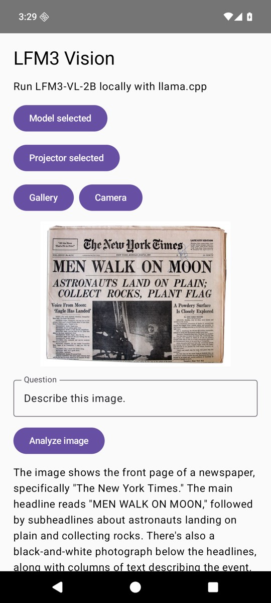

# Image understanding with LFM3-VL and llama.cpp on Android

A local vision question-answering app built with Jetpack Compose. It uses llama.cpp's `mtmd` multimodal library through JNI; images and prompts stay on device. The source is mirrored by the [Android vision tutorial](https://docs.liquid.ai/examples/android/vision-language-model-example).

## Requirements

- Android Studio with API 36 SDK, CMake 3.31.6, and NDK 28.2.13676358
- Android device or emulator with API 33+ and at least 4 GB RAM (6 GB recommended)
- JDK 17
- The matching files from [LiquidAI/LFM3-VL-2B-GGUF](https://huggingface.co/LiquidAI/LFM3-VL-2B-GGUF): `LFM3-VL-2B-Q4_K_M.gguf` and `mmproj-LFM3-VL-2B-Q8_0.gguf`

The model is 1.10 GB and the projector is 203 MB. Download them to your device before opening the app. The first import copies each file into the app's private storage, so allow another ~1.3 GB of free space. The app does not download models or make inference requests over the network.

## Run

```bash
git clone --recurse-submodules https://github.com/Liquid4All/cookbook.git
cd cookbook/examples/android-vision-llamacpp
./gradlew :app:assembleDebug
```

Open this folder in Android Studio and run `app`, or install `app/build/outputs/apk/debug/app-debug.apk` with `adb install -r`. Tap **Choose LFM3-VL model**, **Choose vision projector**, and select the corresponding GGUF files. Then choose an image from **Gallery** or **Camera**, edit the question, and tap **Analyze image**.

For an emulator, copy the files into Downloads first:

```bash
adb push LFM3-VL-2B-Q4_K_M.gguf /sdcard/Download/
adb push mmproj-LFM3-VL-2B-Q8_0.gguf /sdcard/Download/
```

The UI opens Android's document picker for GGUF files and the system photo picker for gallery images. Both user-selected files are copied into private app storage; JNI passes their paths into llama.cpp. `mtmd` preprocesses the image with the projector and the text model generates the answer. The app reloads the models for each question, so a second question also incurs model loading time.

## Model file checksums

| File | SHA-256 |
| --- | --- |
| `LFM3-VL-2B-Q4_K_M.gguf` | `56dac2e192ff0d9ab8507f4f1aeb4aed0463449bbbefaac79497f041c95f21eb` |
| `mmproj-LFM3-VL-2B-Q8_0.gguf` | `c5c5b58d544a18da919172d2d0368090ea1a4a351b6feb7f8a326a264a5918ab` |

The screenshot below is from an API 36 ARM64 emulator using `llama.cpp/tools/mtmd/test-1.jpeg`. The model identified the New York Times front page and its moon-landing headline.



The `llama.cpp` submodule is pinned to a commit with LFM3-VL support. Initialize it with `git submodule update --init` if you cloned without `--recurse-submodules`.
